<div align="center">

# 🧠 NeuroSeg Pro
### Advancing Generalizability in 3D Volumetric Brain Tumor Segmentation Across Diverse Populations

[](https://github.com/ASamy10/NeuroSeg-Pro/releases)
[](#-system-requirements)
[](#-system-requirements)
[](#-gpu--cuda-acceleration)
[](https://monai.io/)
[](https://pennylane.ai/)
[](LICENSE)

---

**NeuroSeg Pro** is an enterprise-grade clinical desktop platform and deep learning research framework designed for automated, generalizable 3D multi-modal MRI brain tumor segmentation. By integrating **Hybrid Quantum-Classical Feature Extraction (Parallel Quantum Bottleneck DynUNet)**, **Multi-Teacher Cross-Population Knowledge Distillation**, and **Demographic Stratified Batch Sampling**, NeuroSeg Pro delivers sub-voxel segmentation accuracy and unprecedented cross-cohort generalizability.

[📥 Download Windows Installer](https://github.com/ASamy10/NeuroSeg-Pro/releases) • [📓 Research Notebook](research/notebooks/training-testing-any-hybrid-teacher-newlabels.ipynb) • [📊 Project Presentation (PDF)](docs/NeuroSeg_Pro_Graduation_Project_Presentation.pdf) • [🔬 Research Docs](research/README.md)

<br/>

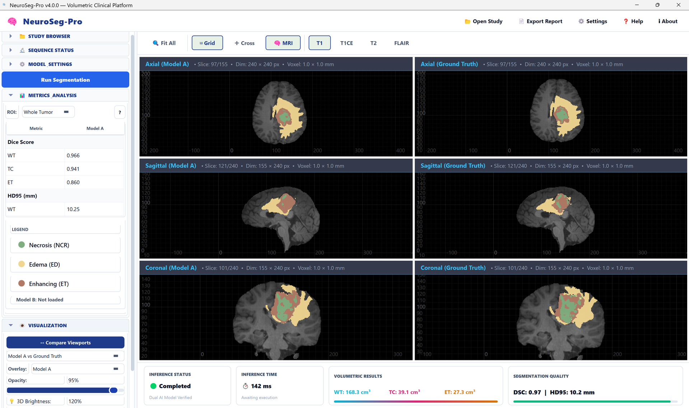
<p><em>NeuroSeg Pro v4.0.0: Interactive triplanar (Axial, Sagittal, Coronal) viewer with synchronized ground-truth comparison, real-time volumetric quantification (WT, TC, ET cm³), and instant sub-second clinical inference.</em></p>

</div>

---

## 📑 Table of Contents
- [🌟 Executive Summary & Clinical Urgency](#-executive-summary--clinical-urgency)
- [🖥️ Clinical Desktop Platform Highlights](#️-clinical-desktop-platform-highlights)
- [👥 Diverse Target Populations & Dataset Diversity](#-diverse-target-populations--dataset-diversity)
- [⚖️ Stratified Batch Sampling (Fairness Strategy)](#️-stratified-batch-sampling-fairness-strategy)
- [⚛️ Hybrid Quantum-Classical DynUNet Architecture](#️-hybrid-quantum-classical-dynunet-architecture)
- [🎓 Multi-Teacher Knowledge Distillation (KD)](#-multi-teacher-knowledge-distillation-kd)
- [📊 Benchmark Results & Quantitative Evaluation](#-benchmark-results--quantitative-evaluation)
- [📓 Research & Training Notebook](#-research--training-notebook)
- [🎯 Clinical Segmentation Workflow](#-clinical-segmentation-workflow)
- [🖥️ System Requirements](#️-system-requirements)
- [🚀 Installation & Quick Start](#-installation--quick-start)
- [🏗️ Software Architecture](#️-software-architecture)
- [👥 Authors, Supervisors & Academic Mentorship](#-authors-supervisors--academic-mentorship)
- [⚖️ License](#️-license)

---

## 🌟 Executive Summary & Clinical Urgency

<p align="center">
  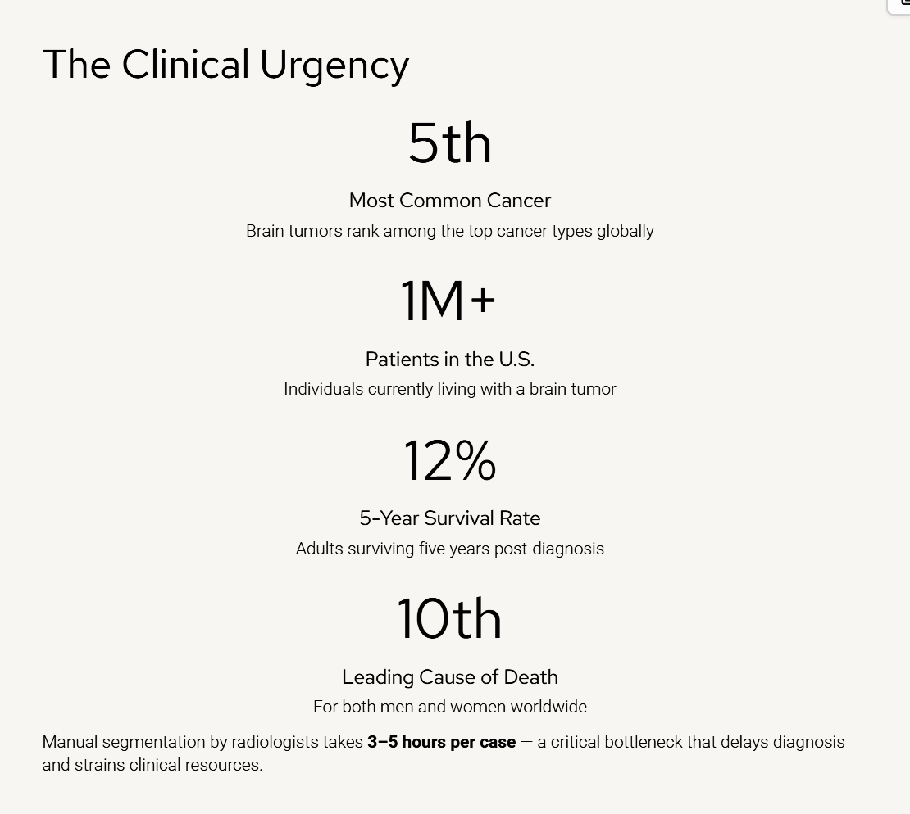
</p>

Brain tumors are the **5th most common cancer** and the **10th leading cause of death** worldwide, carrying a devastating **5-year survival rate of only 12%**. Manual MRI delineation by expert neuroradiologists takes **3 to 5 hours per case**, creating a critical diagnostic bottleneck in oncology workflows.

While deep learning provides a rapid alternative, existing models suffer from three fundamental limitations:
1. **Domain Generalizability Gap**: Discrepancies in scanner field strength (1.5T vs. 3.0T), imaging protocols, and patient demographics cause conventional models to fail when deployed across different hospitals.
2. **Demographic Imbalance**: Datasets are overwhelmingly dominated by standard high-income adult glioma cohorts, leading to high error rates on underrepresented populations such as pediatric and Sub-Saharan African patients.
3. **High Computational Overhead**: 3D Vision Transformers require prohibitive GPU memory, preventing real-time deployment in resource-constrained medical centers.

**NeuroSeg Pro** addresses these challenges head-on with a mathematically rigorous, clinically validated solution.

---

## 🖥️ Clinical Desktop Platform Highlights

<p align="center">
  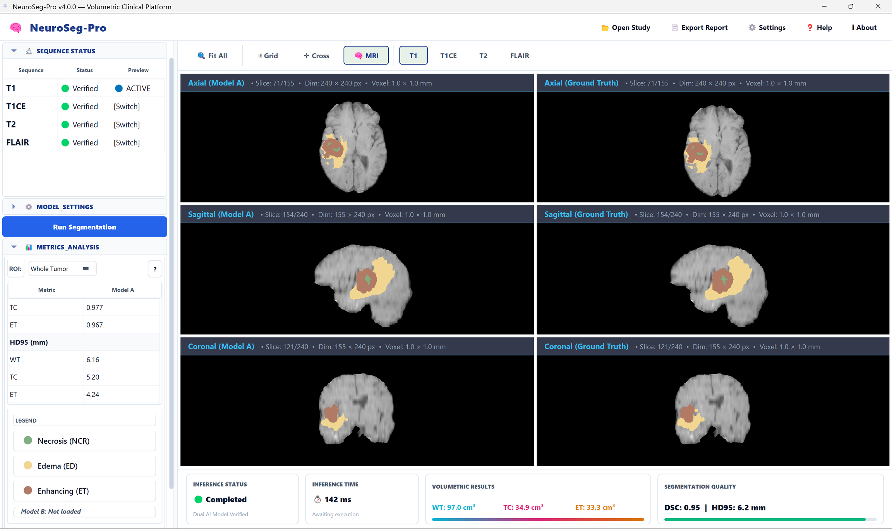
</p>

* **⚡ Ultra-Fast Volumetric Inference**: Optimized PyTorch / MONAI sliding-window inference engine executing 3D volumetric segmentation in **~142 ms** on standard workstations.
* **🩺 Multi-Modal NIfTI Loader**: Native parsing and automated alignment for all four standard MRI contrasts (`T1`, `T1ce`, `T2`, `FLAIR`).
* **📐 Triplanar Synchronized Navigation**: Dual cross-viewport synchronization between AI model predictions and ground-truth annotations across Axial, Sagittal, and Coronal planes.
* **📊 Volumetric Clinical Metrics**: Automated volume estimation ($\text{cm}^3$) for Whole Tumor (WT), Tumor Core (TC), and Enhancing Tumor (ET), paired with DSC and HD95 telemetry.
* **🔕 Silent Windows Deployment**: Complete zero-touch MSI/EXE installer with self-healing virtual environment bootstrapping (`%LOCALAPPDATA%\NeuroSegPro\.venv`).

---

## 👥 Diverse Target Populations & Dataset Diversity

Our study evaluates model generalizability across **5 distinct tumor populations** ($N = 2,824$ multi-modal 3D MRI scans):

<p align="center">
  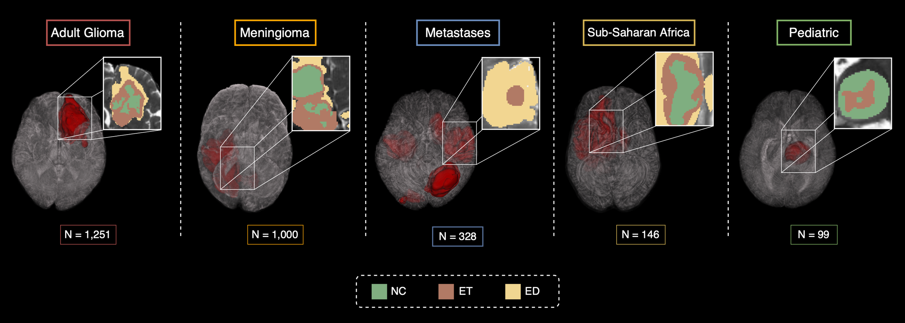
</p>

| Cohort | Clinical Description | Samples ($N$) | Diagnostic & Anatomical Challenge |
| :--- | :--- | :---: | :--- |
| **GLI** | Adult Glioma (BraTS) | **1,251** | Infiltrative margins, heterogeneous necrotic cores |
| **MEN** | Intracranial Meningioma | **1,000** | Dural-based extra-axial masses, displacement of brain tissue |
| **MET** | Brain Metastases | **328** | Multifocal, well-circumscribed lesions with extensive peritumoral edema |
| **SSA** | Sub-Saharan African Glioma | **146** | High protocol variability, varied scanner SNR |
| **PED** | Pediatric Brain Tumors | **99** | Predilection for posterior fossa, distinctive histology |

<p align="center">
  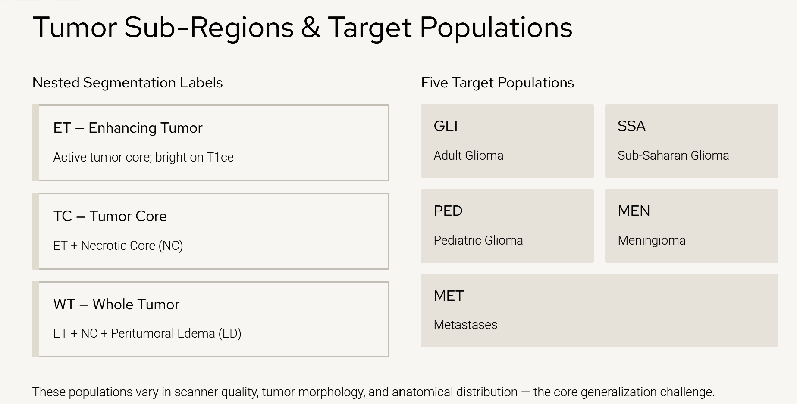
</p>

---

## ⚖️ Stratified Batch Sampling (Fairness Strategy)

To resolve severe population imbalances (e.g., 1,251 Adult Glioma vs. 99 Pediatric cases), we designed a **Stratified Demographic Batch Sampler**:

<p align="center">
  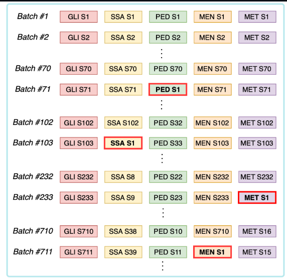
</p>

Each training mini-batch samples exactly one patient from each population: $[\text{GLI}, \text{SSA}, \text{PED}, \text{MEN}, \text{MET}]$. Underrepresented cohorts cycle with replacement, guaranteeing that the model learns unbiased representations across all populations simultaneously.

---

## ⚛️ Hybrid Quantum-Classical DynUNet Architecture

NeuroSeg Pro replaces the deepest spatial bottleneck of a 3D DynUNet with a **Parallel Quantum Bottleneck** utilizing [PennyLane](https://pennylane.ai/):

<p align="center">
  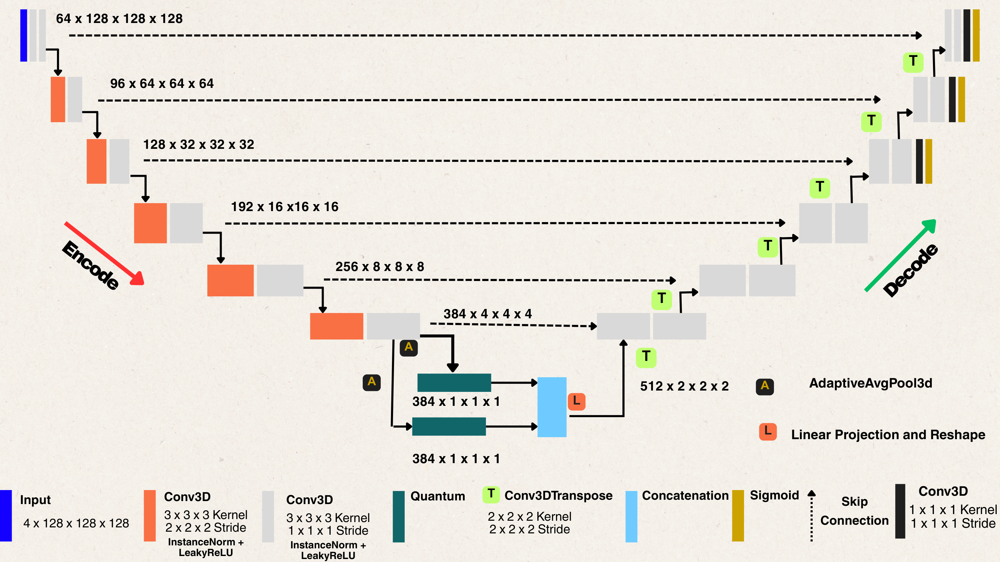
</p>

### Technical Highlights:
* **Deep Feature Projection**: At the bottleneck ($384 \times 4 \times 4 \times 4$), adaptive 3D average pooling compresses spatial representations into $384 \times 1 \times 1 \times 1$.
* **Parallel Variational Circuits**: Two parallel 10-qubit Quantum Processing Layers (`AngleEmbedding` + `StronglyEntanglingLayers`) evaluate expectation values $\langle Z_i \rangle$.
* **Parameter Reduction**: Slashes model parameters from **137.66M to 66.92M (-51.39% parameter reduction)** while boosting validation accuracy:

| Metric (Task03 Proof of Concept) | Classical Model | Hybrid Quantum Model | Improvement |
| :--- | :---: | :---: | :---: |
| **Training Dice** | 0.9262 | **0.9332** | **+0.76%** |
| **Validation Dice** | 0.9229 | **0.9360** | **+1.42%** |
| **Total Parameters** | 137,662,753 | **66,922,971** | **-51.39%** |

---

## 🎓 Multi-Teacher Knowledge Distillation (KD)

Rather than running five separate massive models in clinical practice, we distill five specialized teacher networks into a single, compact **Generalized Student Model**:

<p align="center">
  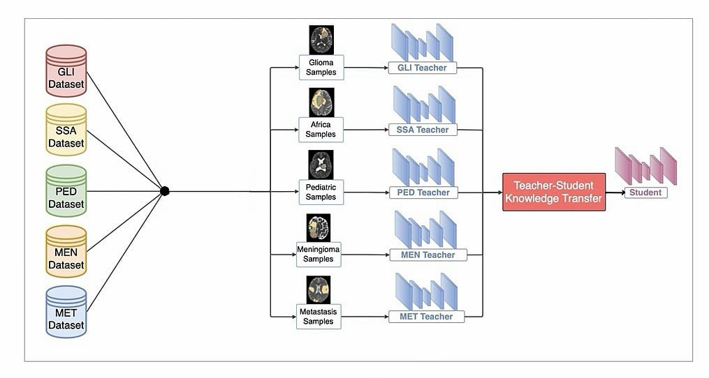
</p>

### Compound Distillation Objective:
The student model is guided by a triple-term loss:

$$\mathcal{L}_{\text{total}} = \mathcal{L}_{\text{seg}}^{\text{DS}} + \alpha \, \mathcal{L}_{\text{logits}}^{\text{DS}} + \beta \, \mathcal{L}_{\text{KL}}$$

<p align="center">
  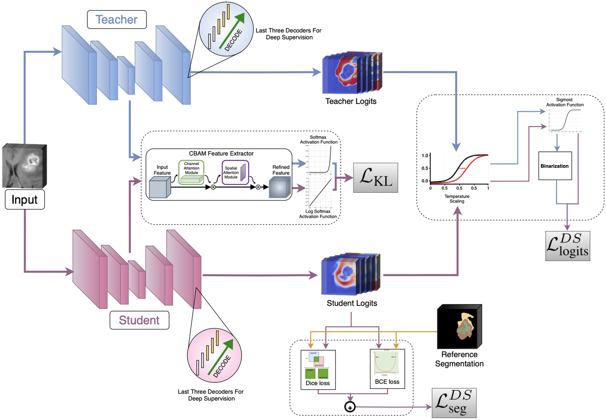
</p>

1. **Deep Supervision Segmentation Loss ($\mathcal{L}_{\text{seg}}^{\text{DS}}$)**: Combines Dice Loss + BCE across the last three decoder levels against reference segmentations.
2. **Logits Distillation ($\mathcal{L}_{\text{logits}}^{\text{DS}}$)**: Uses temperature scaling ($T$) and sigmoid thresholding to transfer probability distributions from teacher decoders to student decoders.
3. **CBAM Intermediate Feature Matching ($\mathcal{L}_{\text{KL}}$)**: Channel and Spatial Attention (CBAM) blocks extract refined spatial attention maps, aligning student and teacher bottleneck features via Kullback-Leibler divergence.

---

## 📊 Benchmark Results & Quantitative Evaluation

### 1. Teacher Models: Hybrid Quantum vs. Classical

<p align="center">
  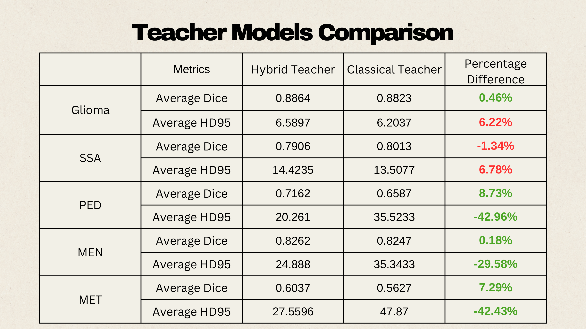
</p>

| Cohort | Metric | Hybrid Teacher (Proposed) | Classical Teacher | Difference (%) |
| :--- | :--- | :---: | :---: | :---: |
| **Glioma (GLI)** | Average Dice<br/>Average HD95 | **0.8864**<br/>**6.59 mm** | 0.8823<br/>6.20 mm | **+0.46%**<br/>+6.22% |
| **Sub-Saharan Africa (SSA)** | Average Dice<br/>Average HD95 | 0.7906<br/>14.42 mm | **0.8013**<br/>**13.51 mm** | -1.34%<br/>+6.78% |
| **Pediatric (PED)** | Average Dice<br/>Average HD95 | **0.7162**<br/>**20.26 mm** | 0.6587<br/>35.52 mm | **+8.73%**<br/>**-42.96% (better)** |
| **Meningioma (MEN)** | Average Dice<br/>Average HD95 | **0.8262**<br/>**24.89 mm** | 0.8247<br/>35.34 mm | **+0.18%**<br/>**-29.58% (better)** |
| **Metastases (MET)** | Average Dice<br/>Average HD95 | **0.6037**<br/>**27.56 mm** | 0.5627<br/>47.87 mm | **+7.29%**<br/>**-42.43% (better)** |

### 2. Multi-Method Benchmark Against SOTA

<p align="center">
  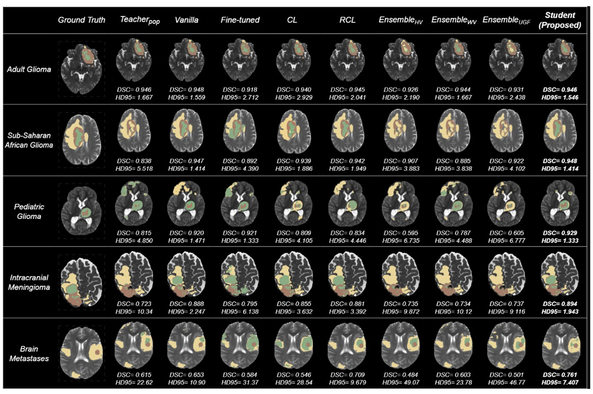
  <br/>
  <em>Visual comparison against Vanilla, Fine-tuned, Continual Learning (CL, RCL), and Ensemble baselines (Hard Voting, Weighted Voting, Uncertainty-Guided Fusion).</em>
</p>

The proposed student model demonstrates remarkable boundary sharpness, maintaining top DSC scores across Adult Glioma (0.946), Sub-Saharan Africa (0.948), Pediatric (0.929), Meningioma (0.894), and Metastases (0.761).

---

## 📓 Research & Training Notebook

The complete PyTorch training, validation, ClearML logging, and evaluation pipeline is open-sourced in:
👉 [`research/notebooks/training-testing-any-hybrid-teacher-newlabels.ipynb`](research/notebooks/training-testing-any-hybrid-teacher-newlabels.ipynb)

For an in-depth mathematical walkthrough and reproduction guide, see the [Research Documentation](research/README.md).

---

## 🎯 Clinical Segmentation Workflow

NeuroSeg Pro processes four multi-parametric MRI sequences (`T1`, `T1ce`, `T2`, `FLAIR`) in NIfTI format (`.nii` / `.nii.gz`):

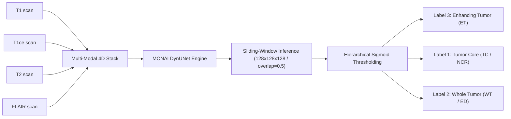

### Tumor Sub-Region Priority & Mapping
1. **Label 3 (Enhancing Tumor - ET)**: High-priority hyper-intense active core on T1ce (overwrites underlying labels).
2. **Label 1 (Necrotic Core - NCR/NET)**: Non-enhancing necrotic structures within the tumor margin.
3. **Label 2 (Peritumoral Edema / Whole Tumor - ED/WT)**: Surrounding FLAIR hyper-intense infiltrative edema.

---

## 🖥️ System Requirements

| Component | Minimum Specification | Recommended Clinical Workstation |
| :--- | :--- | :--- |
| **Operating System** | Windows 10 (64-bit) | Windows 11 Pro / Enterprise (64-bit) |
| **Processor** | Intel Core i5 / AMD Ryzen 5 (4 Cores) | Intel Core i7/i9 / AMD Ryzen 7/9 (8+ Cores) |
| **System Memory (RAM)**| 16 GB RAM | 32 GB+ RAM (for multi-modality 3D loading) |
| **Graphics Card (GPU)**| CPU Fallback Mode (No GPU required) | NVIDIA GeForce RTX 3060 / 4070 / RTX A2000+ (8 GB+ VRAM) |
| **CUDA Toolchain** | Not Required for CPU Mode | CUDA 11.8+ / 12.1+ Runtime Driver |
| **Storage Space** | 6.0 GB Free Disk Space | NVMe SSD with 10 GB+ Free Space |

---

## 🚀 Installation & Quick Start

### Option A: Standalone Windows Installer
1. Download the compiled Windows installer: [`NeuroSegPro_Setup_v4.0.0.exe`](https://github.com/ASamy10/NeuroSeg-Pro/releases).
2. Run the setup wizard and accept Administrator privileges.
3. Launch via your Desktop Shortcut or Start Menu!

### Option B: Local Developer Installation
```powershell
# Clone the repository
git clone https://github.com/ASamy10/NeuroSeg-Pro.git
cd NeuroSeg-Pro

# Create and activate virtual environment
python -m venv .venv
.\.venv\Scripts\Activate.ps1

# Install runtime dependencies
pip install -r requirements.txt

# Run desktop application
python app\main.py
```

---

## 🏗️ Software Architecture

```text
NeuroSeg-Pro/
├── app/                                <-- Application Core Suite
│   ├── main.py                         <-- Application Entrypoint
│   ├── core/
│   │   ├── custom_model.py             <-- DynUNet & ParallelQuantumBottleneck
│   │   ├── inference.py                <-- Sliding-Window Clinical Engine
│   │   └── loader.py                   <-- NIfTI Multi-Modal Reader
│   └── ui/                             <-- PyQt5 Themeable Interface Components
├── assets/
│   ├── diagrams/                       <-- Architectural & Benchmark Figures
│   ├── icons/                          <-- SVG/PNG UI Icons
│   └── screenshots/                    <-- Application Clinical Screenshots
├── docs/
│   └── NeuroSeg_Pro_Graduation_Project_Presentation.pdf
├── research/
│   ├── README.md                       <-- Deep Learning Research Guide
│   ├── notebooks/
│   │   └── training-testing-any-hybrid-teacher-newlabels.ipynb
│   ├── preprocessing/
│   └── src/
├── install.ps1                         <-- Automated Runtime Bootstrapper
├── installer.iss                       <-- Inno Setup Compilation Script
├── NeuroSegPro.vbs                     <-- Windowless Silent VBS Launcher
└── requirements.txt                    <-- Python Package Specifications
```

---

## 👥 Authors, Supervisors & Academic Mentorship

### Core Engineering & Research Team
<table align="center" style="border: none; background: transparent;">
  <tr>
    <td align="center" width="220px">
      <a href="https://github.com/ASamy10">
        <br />
        <br />
        <sub><b>Ahmed Samy Mohsen</b></sub>
      </a><br />
      <small>Computer & Systems Engineering<br/>Deep Learning & AI Training</small>
    </td>
    <td align="center" width="220px">
      <a href="https://github.com/Omareldash">
        <br />
        <br />
        <sub><b>Omar Mohammed Eldash</b></sub>
      </a><br />
      <small>Biomedical Engineering<br/>AI Model & Volumetric Inference</small>
    </td>
    <td align="center" width="220px">
      <a href="https://github.com/mohany203">
        <br />
        <br />
        <sub><b>Mohamed Hany Gabr</b></sub>
      </a><br />
      <small>Biomedical Engineering<br/>Application Architect & GUI Suite</small>
    </td>
  </tr>
</table>

### Academic Supervision & Mentorship
* **Academic Mentor**: **Prof. Mohamed A. Al-Masni** — *Department of Artificial Intelligence, Sejong University, Seoul, South Korea* (Top 2% Stanford / Elsevier World Ranking Scientists).
* **Supervisors**:
  * **Dr. Rasha Ali** — *Computer and Systems Engineering Department*
  * **Dr. Rana Hossam** — *Biomedical Engineering Department*

---

## ⚖️ License
This project is open-source under the **MIT License**. See [`LICENSE`](LICENSE) for details.
